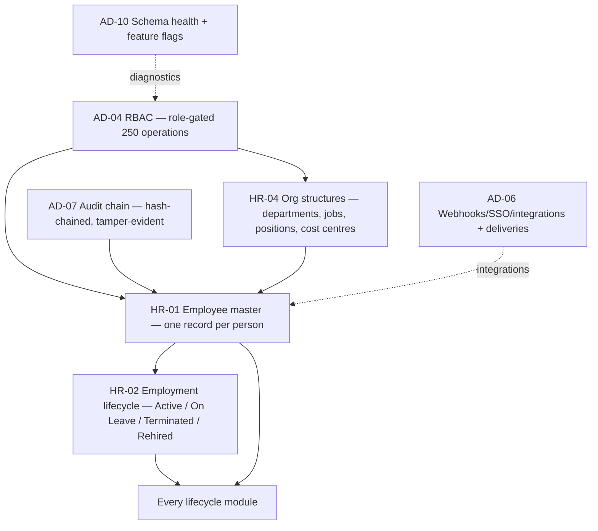
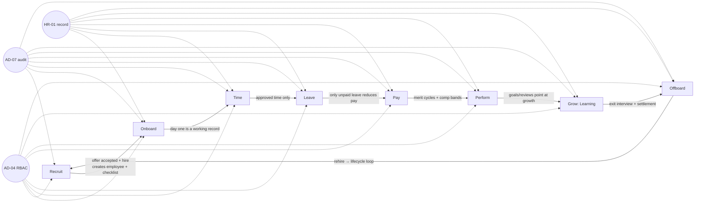
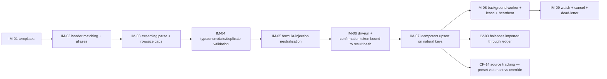

# Karmathy HCM — Feature Linkages & Dependencies

**Date:** 2026-11-03 · **Owner:** Super Agent · **Status of record:** `docs/product/FEATURE_MATRIX.md`

This document is the **dependency atlas** of the Karmathy capability map. The matrix
answers *what* exists; this answers *what each capability needs, and who needs it* —
so sequencing, migration, testing and cut-downs never rip a load-bearing wall out.

**Source of truth (in order):**
1. `docs/product/FEATURE_CATALOG.md` — the target specification (what we build toward)
2. `docs/product/FEATURE_MATRIX.md` — the per-capability status of record (28 **implemented** / 59 **partial** / 56 **missing** as of the Phase-0 baseline; the roadmap ledger `FEATURES_TRACKING.md` currently quotes **38/143 implemented** after the batches shipped since — this document does not re-count, it links)
3. This atlas — the dependency edges, derived from the served code, its models and its suites

**How to read a row:** `Depends on` = everything that must exist before *this* capability can work.
`Feeds into` = capabilities that break, or lose their evidence, if this one is removed or regresses.
Status words are identical to the matrix. `AD-*` is enforced underneath everything — see
[The two foundations](#the-two-foundations).

---

## The two foundations (everything stands on these)



- **AD-04 (RBAC)** — enforced at every endpoint by `require_roles`; a role-gating regression in any wave fails `security_test_suite` (1,475 checks) before release. *Removing it invalidates the existence of every other row, all statuses included.*
- **AD-07 (audit chain)** — every mutation writes to a hash-chained trail; `AD-07` is what makes "who approved this payslip?" a database fact rather than a hope. Hash-chained also means 200+ test rows per suite prove it on every boot.
- **HR-01 / HR-02 / HR-04** — the identity tier. If the person record is wrong, the payslip is wrong, the termination is wrong, the roster is wrong. All lifecycle edges below ultimately trace to these three.

---

## The employee thread (module-to-module linkages)



Every arrow above is a real, callable edge — the `/offers/{id}/hire` transaction creates the employee
and the onboarding checklist; the pay run prints *only* approved time and leave; an offboarding
completion flips the HR-02 state machine and unlocks the rehire path into Recruiting.

---

## Payroll dependency tree

```mermaid
flowchart TB
    HR01[HR-01 pay profile anchor (HR is the identity)]
    TU[TM-03 / TM-05 — approved hours, overtime, cut-off]
    LV3[LV-03 approved leave ledger]
    PM06[PY-06 merit bands — PM links in]
    RULE[PY-09 verified jurisdiction rule pack (contracts/rules)]
    SPLIT[PY-10 generic calculation separated from verified statutory rule]
    COMP[PY-02 pay components + PY-01 structures/pay profiles]
    RUN[PY-04 run: Draft → Processing → Approved → Finalized → Paid]
    RECON[PY-04 reconciliation — expected vs paid, payslip row-by-row]
    SOS[Segregation of duties — processor ≠ approver]
    LOCK[PY-05 finalized — payslips read-only, immutable history]
    PAYSLIP[PY-03 payslip drill-down — inputs_json trace]
    EXPORT[PY-07 bank export — next after the run locks]

    RULE --> SPLIT --> RUN
    TU --> RUN
    LV3 --> RUN
    COMP --> RUN
    PM06 --> COMP
    RUN --> RECON --> SOS --> LOCK --> PAYSLIP --> EXPORT
```

Not weak links: **PY-03** (implemented) does the consuming; **PY-10** (implemented) refuses unverified
jurisdictions with `422 rule_pack_not_verified` and writes nothing. **PY-07 (bank export)** cannot be
built before PY-04 closes the approval/lock loop — anything earlier inverts the risk order.

---

## Import pipeline dependency chain



Full evidence: `import_test_suite` (1,800+ assertions across its cases), `job_worker_test_suite`,
`e2e/import-queued.spec.ts`. **IM-10 (upload retention)** is `missing` for a real reason, not a
missed edge: the purge exists, is tested, and nothing schedules it — retention is a schedule, not a callable.

---

## Minimum viable platform — what must not be ripped out

| Keystone | Why | What breaks if you remove it |
|---|---|---|
| `AD-04` | 250 role-gated operations; negative tests per role per operation | Every module fails open — the whole catalogue loses its evidence |
| `AD-07` | Hash-chained audit + job queue | Payroll, payslip approval, hire conversion — legally unattributable |
| `HR-01` | Employee master + history begin | Every module's FK integrity; HR-03, PY-01, TM, LV |
| `HR-02` | State machine: Active → On Leave → Terminated → Rehired | Termination/rehire guards, OB-06, AN turnover metrics |
| `HR-04` | Org backbone | RC-02 positions, PY profiles, CF presets, SC assignments |
| `PY-03` | Only implemented payroll path | PY-04 reconciliation, PY-07 export, OB-06 final settlement |
| `LV-03` | Ledger is the sum of signed rows | LV-02 approvals, PY-03 handoff, all balance reports |
| `TM-05` | Cut-off + approve | PY-03 input integrity |
| `CF-01/02` | Presets validated + dependency graph enforced in code | Industry onboarding; every preset silently degrades |
| `IM-06/07` | Dry-run + idempotent | Tenant migrations; balances arriving through the ledger |
| `AD-06` | Integration surface (webhooks, SSO, deliveries) | SCIM, external verifiers — none can land |
| `AN-02` | Catalogued metric definitions | All dashboards — "numbers we can't define" are not numbers |

---

## Dependency atlas by domain

Statuses: `✅` implemented · `◐` partial · `○` missing (from the matrix of 2026-10-21; see header note)

### AD — Administration & platform security

| ID | Cap | St | Depends on | Feeds into |
|---|---|---|---|---|
| `AD-01` | Tenant setup, branding, theme (WCAG-aware) | ◐ | `AD-04`, `AD-07` | `CF-14`, `AD-02`, `AD-10` |
| `AD-02` | Module entitlements + configurable nav | ◐ | `AD-04`, `CF-02` | `UX-02`, `AD-10` |
| `AD-03` | Locale/TZ/currency/date/working week | ○ | `AD-01` | `PY-08`, `PY-09`, `SC-01` |
| `AD-04` | **RBAC + scoped authorisation + access reviews** | ✅ | — (foundation) | Every capability below |
| `AD-05` | Workflow/approval configuration | ○ | `AD-04`, `AD-07` | `RC-01`, `LV-02`, `SC-06`, `OB-03` |
| `AD-06` | API credentials, webhooks, integration health | ◐ | `AD-04`, `AD-07` | `RC-08`, `BN-06`, `AD-08` (webhook health) |
| `AD-07` | **Audit chain + monitoring + background jobs** | ✅ | — (foundation) | Every mutation, incl. payroll, hiring, exits |
| `AD-08` | Backup & restore verification | ○ | `AD-04`, `AD-07` | `AD-09`, `IM-10` |
| `AD-09` | Retention / export / erasure workflows | ○ | `AD-04`, `AD-07`, `IM-10` | `HR-12`, `BN-03`, privacy obligations |
| `AD-10` | Feature flags + release tracking + diagnostics | ◐ | `AD-04`, `AD-07` | `AD-02` (frontend gating), platform ops |

### HR — Core employee record

| ID | Cap | St | Depends on | Feeds into |
|---|---|---|---|---|
| `HR-01` | Employee master + number + contacts | ◐ | `AD-04`, `HR-04` | Everything that references a person |
| `HR-02` | Employment status/type/dates + lifecycle machine | ◐ | `HR-01`, `AD-04` | `OB-06`, `OB-05`, `PY-03`, `TM`, `LV`, `AN-01` |
| `HR-03` | Effective-dated changes + history | ◐ | `HR-02` | `AN-06`, `PY-05`, `RC-05`, payroll corrections |
| `HR-04` | Departments/positions/grades/cost centres | ◐ | `AD-04` | `RC-02`, `PY-01`, `CF-03`, `AN-01` |
| `HR-05` | Multi-entity + multi-location | ◐ | `HR-04` | `SC-08`, `CF`, `AN-05` |
| `HR-06` | Org chart + directory | ◐ | `HR-01`, `HR-04`, `HR-09`, `AD-04` | `UX-04`, `UX-06`, `LN` |
| `HR-07` | Documents + expiry + acknowledgements | ◐ | `HR-01`, `AD-07` | `OB-02`, `LN-03`, `OB-06` |
| `HR-08` | Custom fields + controlled bulk updates | ○ | `IM-04`, `IM-06`, `HR-11` | `CF-12`, `CF-14` |
| `HR-09` | Manager assignments + delegated responsibility | ◐ | `HR-01`, `AD-05`, `AD-04` | `LV-02`, `TM-04`, `OB-03`, `UX-04` |
| `HR-10` | Contingent workers | ○ | `HR-01`, `HR-02` | `PY-02` (treatment), compliance scenarios |
| `HR-11` | Validation + duplicates + record merge | ◐ | `AD-07`, `HR-01` | `IM-04`, `HR-08`, `AN-02` |
| `HR-12` | Export + retention + erasure | ○ | `AD-07`, `AD-09` | `AD-09` (legal requests), `IM-10` |

### RC — Recruiting

| ID | Cap | St | Depends on | Feeds into |
|---|---|---|---|---|
| `RC-01` | Requisitions + budgets + approvals | ◐ | `HR-04`, `HR-09` | `RC-02`, `RC-05`, `AN-01` |
| `RC-02` | Position/job description management | ◐ | `HR-04` | `RC-05` |
| `RC-03` | Candidates/applications/stages/talent pools | ◐ | `AD-04` | `RC-04`, `RC-05`, `OB`, `RC-07` |
| `RC-04` | Interview scheduling + kits + scorecards | ○ | `RC-03`, `HR-09` | `RC-05` |
| `RC-05` | **Offer approvals + hire transaction** | ◐ | `RC-03`, `RC-01`, `RC-02` | `OB`, `RC-08`, `AN-01` |
| `RC-06` | Candidate comms + career site | ○ | `RC-03` | `RC-07` |
| `RC-07` | Funnel analytics + time-to-fill | ○ | `RC-01..06` | `AN-01` |
| `RC-08` | Background-check + e-signature status | ✅ | `AD-06`, `AD-04` | `OB` (hire evidence), `AD-09` |

### OB — Onboarding & offboarding

| ID | Cap | St | Depends on | Feeds into |
|---|---|---|---|---|
| `OB-01` | Resumable checklists + preboarding | ◐ | `RC-05`, `HR-01` | `OB-02`, `OB-03`, `OB-04` |
| `OB-02` | Information collection + acknowledgements | ◐ | `HR-07`, `OB-01` | `OB-04`, compliance evidence |
| `OB-03` | Equipment/access/training tasks + owners | ○ | `OB-01`, `HR-09` | `OB-04` |
| `OB-04` | Probation tracking + confirmation | ○ | `OB-02`, `HR-02` | `LN-02`, `PY-01` |
| `OB-05` | Transfers, promotions, contract renewals | ○ | `HR-02`, `HR-03` | `PY-01`, `PM-06` |
| `OB-06` | Exit interviews, revocation, settlement | ◐ | `HR-02`, `HR-07`, `AD-07` | `PY-03`, `HR-03`, `OB-07` |
| `OB-07` | Rehire handling + dashboards | ○ | `OB-06`, `HR-02` | `RC-05` (rehire loop) |

### TM — Time & attendance

| ID | Cap | St | Depends on | Feeds into |
|---|---|---|---|---|
| `TM-01` | Clock in/out + breaks + timesheets | ◐ | `HR-01`, `HR-02` | `TM-03`, `TM-05`, `SC-10` |
| `TM-02` | Attendance policies + missed-punch fixes | ○ | `TM-01` | `TM-04` |
| `TM-03` | Cross-midnight + overtime + rounding | ◐ | `TM-01` | `PY-03`, `SC-10` |
| `TM-04` | Shift-based + fixed-schedule attendance | ○ | `TM-01`, `HR-09` | `SC-01` |
| `TM-05` | Timesheet lock after cut-off + adjustments | ◐ | `TM-01` | `PY-03`, `LV-05` |

### LV — Leave

| ID | Cap | St | Depends on | Feeds into |
|---|---|---|---|---|
| `LV-01` | Leave types/accruals/carry-over/holidays | ◐ | `HR-01`, `CF-05` | `LV-02`, `LV-03` |
| `LV-02` | Requests/approvals/overlap/delegation | ✅ | `LV-03`, `AD-04`, `HR-09` | `PY-03`, `UX-04` |
| `LV-03` | **Ledger-backed balance transactions** | ✅ | `IM-07` (ledger imports), `AD-07` | Every balance number in the product |
| `LV-04` | Team availability + absence calendars | ○ | `LV-03`, `HR-06` | `UX-04`, `SC-03` |
| `LV-05` | Approved leave → payroll | ◐ | `LV-03`, `TM-05` | `PY-03` |

### SC — Scheduling & rostering

| ID | Cap | St | Depends on | Feeds into |
|---|---|---|---|---|
| `SC-01` | Templates/drafts/publish | ◐ | `CF-04`, `HR-01` | `SC-06`, `SC-09`, `SC-10` |
| `SC-02` | Demand-based staffing | ○ | `AN-01`, `SC-01` | `SC-04` |
| `SC-03` | Availability + approved leave | ○ | `HR-01`, `LV` | `SC-04` |
| `SC-04` | **Hard constraints (rest/hours/certs/double-book)** | ○ | `SC-02`, `SC-03` | `SC-01` |
| `SC-05` | Soft constraints (fairness/continuity/cost) | ○ | `SC-04` | `SC-01` |
| `SC-06` | Swaps + replacements | ◐ | `SC-01`, `HR-09` | `SC-10` |
| `SC-07` | Coverage gaps + overtime alerts | ○ | `SC-01`, `SC-02` | `AN-07` |
| `SC-08` | Multi-location + project assignments | ○ | `HR-05` | `SC-09` |
| `SC-09` | Schedule versioning + change history | ○ | `SC-01`, `OB` | `UX-05` |
| `SC-10` | Planned vs actual hours + cost | ○ | `SC-01`, `TM-03` | `AN-01`, `PY-02` |

### PY — Payroll

| ID | Cap | St | Depends on | Feeds into |
|---|---|---|---|---|
| `PY-01` | Schedules/structures/components (effective-dated) | ◐ | `HR-01`, `HR-03`, `HR-04` | `PY-02`, `PY-03`, `OB-05` |
| `PY-02` | Earnings/deductions (benefit + incentive) | ◐ | `PY-01` | `PY-03`, `BN-02`, `SC-10` |
| `PY-03` | **Approved time/leave inputs + payslip trace** | ✅ | `TM-05`, `LV-03`, `PY-01`, `PY-02`, `AD-04` | Everything payroll |
| `PY-04` | Run lifecycle + approval + reconciliation | ◐ | `PY-03`, `PY-10`, `AD-06`, `AD-07` | `PY-05`, `PY-07`, `AN`, controls |
| `PY-05` | Historical record + controlled correction | ◐ | `PY-04`, `AD-07`, DB triggers | audit + accounting |
| `PY-06` | Salary revisions + total-comp statements | ◐ | `PY-03`, `PY-01`, `PM-02` | `OB-05` |
| `PY-07` | Bank export integration | ○ | `PY-04` (approved/finalized) | payroll close |
| `PY-08` | Explicit currency + pay-period semantics | ◐ | `AD-03` (missing), `PY-01` | `PY-09` |
| `PY-09` | Jurisdiction rules + versioning + test fixtures | ◐ | `PY-08`, `AD-07`, `PY-01` | `PY-10`, `PY-03` |
| `PY-10` | **Generic calc separated from verified statutory** | ✅ | `PY-09` | `PY-04`, `PY-03` |

### BN — Benefits & HR service

| ID | Cap | St | Depends on | Feeds into |
|---|---|---|---|---|
| `BN-01` | Plans/eligibility/enrolment windows | ◐ | `HR-01`, `HR-02` | `BN-02`, `BN-03`, `PY-02` |
| `BN-02` | Employer contributions + claims | ○ | `PY-02` | `PY-05`, `BN-03` |
| `BN-03` | Renewal reminders + documentation | ○ | `BN-01`, `HR-07` | `BN-04` |
| `BN-04` | HR help/cases + SLA + escalation | ◐ | `HR-01`, `AD-04` | `BN-05`, `AI-04` |
| `BN-05` | Knowledge base + self-service | ○ | `BN-04`, `CF-13` | `UX-06` |
| `BN-06` | External administrator/provider integration | ○ | `AD-06`, `BN-01` | integration platform |

### PM — Performance

| ID | Cap | St | Depends on | Feeds into |
|---|---|---|---|---|
| `PM-01` | Goals + OKR-style + continuous feedback | ◐ | `HR-01`, `AD-04` | `PM-02`, `LN-06`, `AN` |
| `PM-02` | Review cycles + self-assessments | ◐ | `PM-01` | `PY-06`, `PM-05`, `PM-06` |
| `PM-03` | Competency + calibration | ○ | `PM-02` | `PM-06` |
| `PM-04` | Improvement plans + recognition | ○ | `PM-02` | `LN-06` |
| `PM-05` | Succession + talent reviews + pools | ◐ | `PM-02`, `LN` (talent pools) | `LN-04`, `LN-05`, `RC` |
| `PM-06` | Promotion readiness + talent analytics | ○ | `PM-05`, `PM-03` | `PY-06` |

### LN — Learning & talent

| ID | Cap | St | Depends on | Feeds into |
|---|---|---|---|---|
| `LN-01` | Courses + enrolments + learning paths | ◐ | `HR-01` | `LN-02`, `LN-03`, `LN-04` |
| `LN-02` | Mandatory training assignments | ○ | `LN-01`, `OB` | compliance evidence (→ `AD-07`) |
| `LN-03` | Certifications + expiry/renewal reminders | ◐ | `LN-01`, `HR-07` | `SC-04` (cert constraint), `OB` |
| `LN-04` | Skills taxonomy + proficiency levels | ○ | `LN-01` | `LN-05` |
| `LN-05` | Skill gaps + career paths + internal roles | ○ | `LN-04`, `PM-05` | `RC`, `AN` |
| `LN-06` | Mentoring + development plans | ○ | `PM-04`, `LN-01` | `PM-04` |
| `LN-07` | Completion + effectiveness analytics | ○ | `LN-01..03` | `AN-01` |

### AN — Analytics & forecasting

| ID | Cap | St | Depends on | Feeds into |
|---|---|---|---|---|
| `AN-01` | Headcount/hiring/turnover/labour-cost | ◐ | `HR-01`, `TM`, `LV` | `AN-02`, `AN-03`, `CF-06`, `SC-02` |
| `AN-02` | Metric definitions + lineage + drill-down | ◐ | `AN-01`, `IM-11` | `AN-03..AN-08` |
| `AN-03` | Headcount/attrition projections | ○ | `AN-02`, `AD-04` | `AN-05` |
| `AN-04` | **Demand + labour-cost forecasts** | ◐ | `AN-02`, `SC-01` | `AN-05`, `SC-02` |
| `AN-05` | Hiring plans + staffing scenarios | ◐ | `AN-03`, `AN-04`, `CF-06` | `AN-06` |
| `AN-06` | Actual vs plan reconciliation | ○ | `AN-05` | `CF-09` readiness |
| `AN-07` | Accuracy + model version + confidence | ◐ | `AN-04`, `AD-07` | `AN-02`, `AI-06` |
| `AN-08` | Scheduled reporting + export + dashboards | ◐ | `AN-02`, `AD-06` | `AD-10` (health surfaces), customers |

### UX — Experience

| ID | Cap | St | Depends on | Feeds into |
|---|---|---|---|---|
| `UX-01` | Role homepages + action queues | ◐ | `AD-02` (flag-aware nav) | `UX-04`, `UX-05` |
| `UX-02` | Nav + accessible global search | ◐ | `AD-02`, `AD-04` | all screens |
| `UX-03` | ESS profile/documents/leave/time/payslips | ◐ | `HR-01`, `AD-04`, `IM-11` | self-service HR load |
| `UX-04` | Manager team availability + approvals | ◐ | `HR-09`, `LV-03`, `TM` | leave, time & review decisions |
| `UX-05` | Notification centre + preferences | ◐ | `AD-06`, `OB` | user action latency |
| `UX-06` | Announcements/directory/help centre | ◐ | `UX-02` | adoption |
| `UX-07` | Saved views + keyboard nav + palette | ◐ | `UX-02` | productivity of heavy users |
| `UX-08` | **Mobile/tablet + accessible interaction** | ◐ | `UX-02`, `UX-09` | CI (`responsive.spec.ts`, axe-core) |
| `UX-09` | States (loading/empty/error/retry) | ◐ | — | every page |
| `UX-10` | **Public contact form with rate limit** | ✅ | — (public, intentionally open) | owner welcome flow (CF) |

### IM — Import/export pipeline

| ID | Cap | St | Depends on | Feeds into |
|---|---|---|---|---|
| `IM-01` | Downloadable templates | ✅ | `HR-04` (column models) | `IM-02`, `CF-08` |
| `IM-02` | Header matching + aliases + rejects unknown | ✅ | `IM-01` | `IM-04` |
| `IM-03` | Streaming UTF-8 parse + row/byte limits | ◐ | `IM-02` | `IM-04` |
| `IM-04` | Type/enum/date/duplicate validation | ✅ | `IM-02`, `IM-03`, `HR-11` | `IM-06` |
| `IM-05` | Formula-injection neutralisation | ◐ | `IM-03` | every import & export |
| `IM-06` | **Dry run + confirmation token (hashed)** | ✅ | `IM-04`, `IM-05` | `IM-07` |
| `IM-07` | **Idempotent upsert on natural keys** | ✅ | `IM-06`, `HR-01` (codes) | `IM-08`, `LV` (ledger), all bulk loads |
| `IM-08` | Background execution + leases | ✅ | `AD-07` (jobs) | `IM-09` |
| `IM-09` | Watch/progress/cancel/dead-letter | ✅ | `IM-08` | `IM-10` |
| `IM-10` | Upload retention + deletion + schedule | ○ | `IM-09`, `AD-07` | `AD-09` |
| `IM-11` | Masked personal values (errors/logs) | ✅ | `AD-07` (redaction), `IM-04` | everything that logs |
| `IM-12` | Salary units explicit — never annual by default | ✅ | `IM-01` | `PY-01` |

### CF — Configuration & onboarding

| ID | Cap | St | Depends on | Feeds into |
|---|---|---|---|---|
| `CF-01` | **Versioned, schema-validated presets** | ✅ | `AD-04` | `CF-02..CF-10`, every module's starting config |
| `CF-02` | **Module dependency graph enforced in code** | ✅ | `AD-04` | `AD-02`, preset integrity, `CF-09` |
| `CF-03` | Workforce/org templates | ✅ | `CF-01` | `HR-04`, `HR-02` |
| `CF-04` | Shift templates + working patterns | ✅ | `CF-01` | `SC-01`, `TM-04` |
| `CF-05` | Leave types + accrual parameters | ✅ | `CF-01` | `LV-01` |
| `CF-06` | Dashboards/KPIs/action queues per preset | ✅ | `CF-01` | `UX-01`, `AN-01` |
| `CF-07` | Forecast drivers per preset | ✅ | `CF-01` | `AN-04` |
| `CF-08` | Employee-import templates per preset | ✅ | `CF-01`, `IM-01` | onboarding, exports |
| `CF-09` | Setup validations + readiness probe | ✅ | `CF-02` | `CF-12` |
| `CF-10` | Explicit exclusions per preset | ✅ | `CF-01` | compliance risk register |
| `CF-11` | Ten-step journey + resumable progress | ○ | `CF-02`, `CF-09` | `CF-12` |
| `CF-12` | Gap detection + explanation + fix | ◐ | `CF-09` | `AD-02` (fix lands where user lives) |
| `CF-13` | Curated help index | ○ | `AD-01`, `AD-02` | `AI-05`, `BN-05`, support load |
| `CF-14` | Default-vs-tenant-vs-override tracking | ✅ | `CF-01` | `AD-09`, audit of config |

### AI — Intelligence (Phase 8, behind the release gate by design)

| ID | Cap | St | Depends on | Feeds into |
|---|---|---|---|---|
| `AI-01` | Tier A — policy search + citations | ○ | `CF-13`, `AD-04`, `AD-07` | Tier A sequence |
| `AI-02` | Tier A — document classification + human verify | ○ | `OB-02`, `AD-04`, `AI-12` | onboarding effort |
| `AI-03` | Tier A — drafting JD/comms/help responses | ○ | `CF-13` | `AD-02` (labels), help |
| `AI-04` | Tier A — summarise authorised cases/reports | ○ | `BN-04`, `AD-04` | `UX-06` |
| `AI-05` | Tier A — config-gap explanations | ○ | `CF-12` | `CF-06` (KPIs), onboarding |
| `AI-06` | Tier B — forecast explanation + comparison | ○ | `AN-07` | `AN-05` |
| `AI-07` | Tier B — schedule recommendations | ○ | `SC-04` | `SC-01`, `SC-07` |
| `AI-08` | Tier B — skills-gap recommendations | ○ | `LN-05` | `LN-01` |
| `AI-09` | Tier B — workforce cost + attrition analysis | ○ | `AN-02`, `AN-04` | `PY-06` |
| `AI-10` | Tier B — payroll exception explanations | ○ | `PY-03`, `PY-10` | `PY-04` transparency |
| `AI-11` | Tier C — draft change + approval + execute | ○ | `AI-12`, `AI-13` | everything above |
| `AI-12` | **Mandatory controls — land with first Tier A** | ○ | `AD-04`, `AD-06` | existence of any AI capability |
| `AI-13` | Prohibitions (autonomous decisions) | ○ | `AI-12` | same |

---

## Sequencing rules the atlas encodes

1. **Foundations before modules, modules before integrations, analysis before AI.** No `AD-*` or `HR-*` edge may regress without the release gate blocking.
2. **`AD-04` and `AD-07` are unremovable.** Any capability claiming "done" without them is `missing`.
3. **New modules run through the atlas before they are proposed**: their dependencies must exist or the proposal is an assembly of `missing` IDs — it is a roadmap item, not a feature.
4. **Every `missing` with an inflow edge gets a dependency, not a promise**: e.g. `PY-07` (bank export) unblocks only when `PY-04` closes its approval and lock; `SC-04` (constraint solver) unblocks only when `SC-02/03` exist.
5. **`UX-08` closes every UI distinction that isn't proven in a width** — mobile, tablet, 360 px up, axe-core or a written exception.
6. **AI starts only when the first Tier A capability and its controls land together** — `AI-12` is not aftercare for `AI-01`; it is part of `AI-01`.
7. **Honesty clause:** no status in this atlas is better than the matrix row it links. A snapshot here is stale the moment a suite goes green — re-check against the matrix, never against this atlas.

---

## Traceability

| Artefact | Path | Role |
|---|---|---|
| Target specification | `docs/product/FEATURE_CATALOG.md` | WHAT to build |
| Capability status of record | `docs/product/FEATURE_MATRIX.md` | Per-capability verdict + evidence |
| Roadmap ledger | `FEATURES_TRACKING.md` (repo root) | What's shipped/deployed/verified |
| Row-level evidence annex | `docs/validation/FEATURE_MATRIX.md` | Named commits + suites |
| Verification method | `docs/validation/TEST_COUNT.md` | Why the checks mean anything |
| Release gates & sequencing | `docs/release/` | Why order is dependency order |
| Audit chain verification | `python -m scripts.verify_audit_chain` | Is the trail trustworthy today |
| Hire→terminated proof | `scripts/e2e_lifecycle.py` | End-to-end demonstration |

---

*Maintainers: change the matrix first, then this atlas, then anything that links them.*
